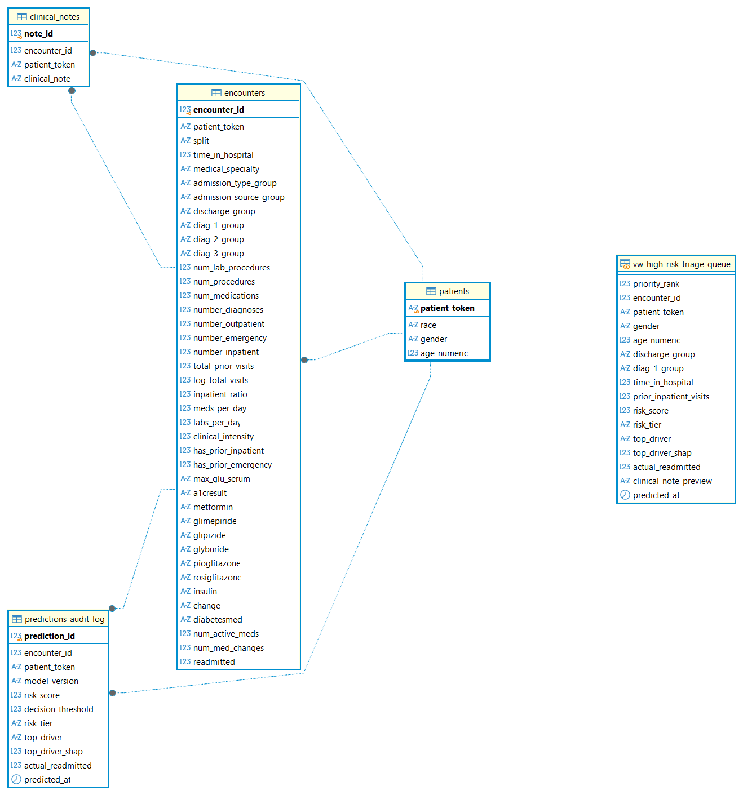
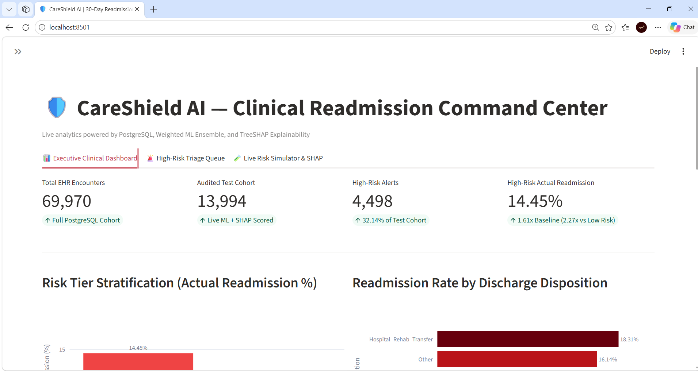
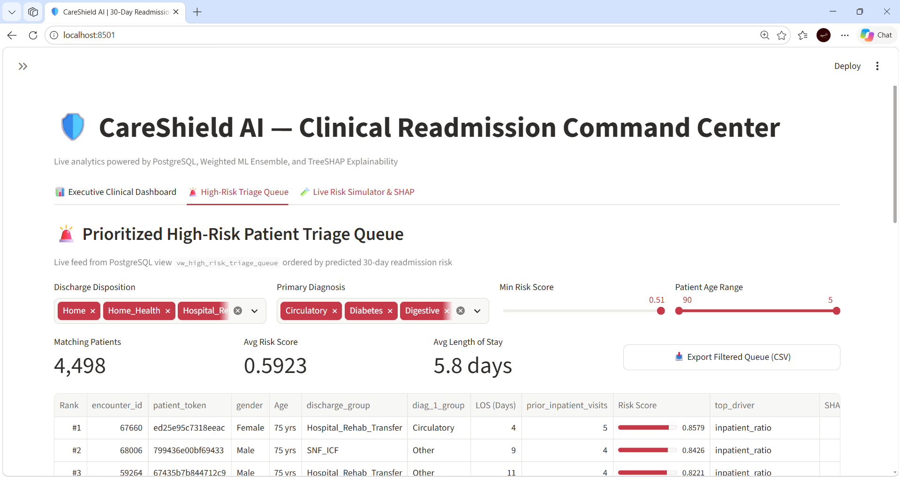
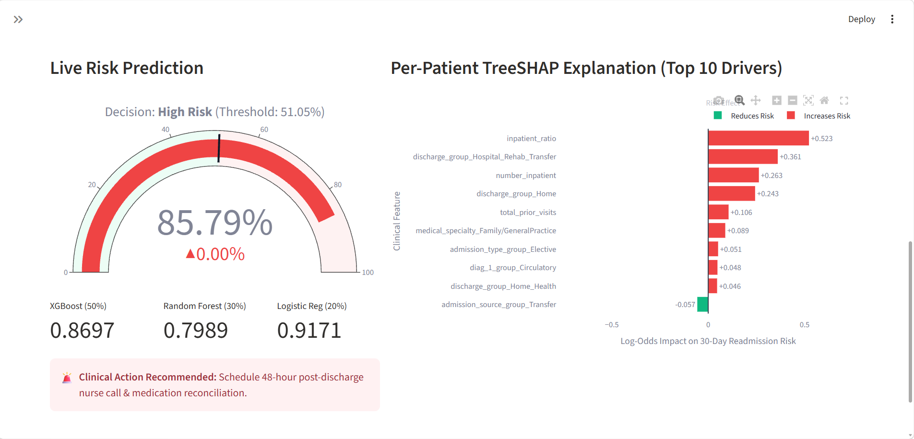
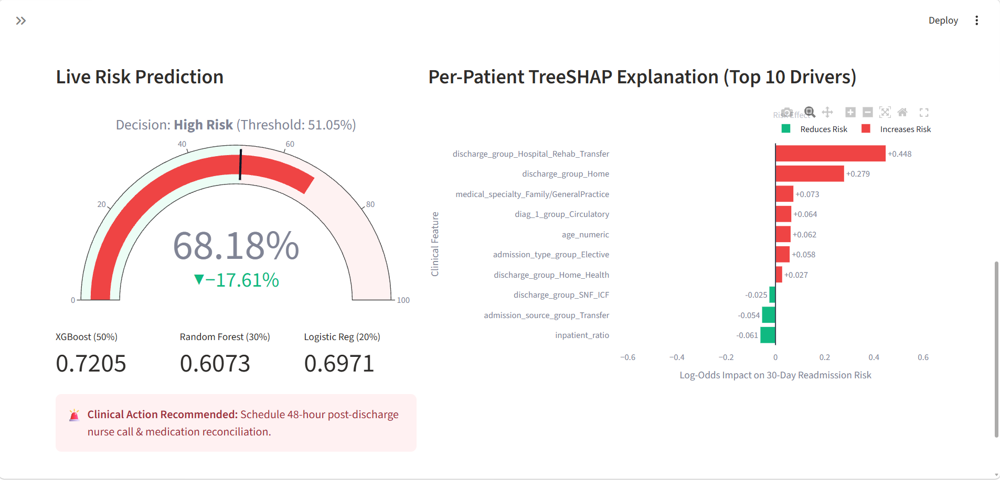

# 🛡️ CareShield AI — 30-Day Hospital Readmission Risk Engine

**CareShield AI** is an end-to-end clinical decision support system designed to predict **30-day hospital readmission risk** for diabetic patients. Built as a production-grade NTI Machine Learning graduation project, it integrates **HIPAA-compliant data de-identification**, **normalized PostgreSQL EHR warehousing**, a **weighted Machine Learning Ensemble**, **per-patient TreeSHAP explainability**, and an interactive **3-tab Streamlit Clinical Command Center**.

---

## 🎯 Key Clinical & Technical Impact

| Metric | Production Value | Clinical Significance |
| :--- | :---: | :--- |
| **Total EHR Cohort** | `69,970` encounters | Stored in normalized PostgreSQL (`careshield_db`) |
| **Audited Test Cohort** | `13,994` encounters | Live DB inference + TreeSHAP logged to audit table |
| **Test ROC-AUC / PR-AUC** | `0.6451` / `0.1599` | Exact match between offline evaluation and live DB inference |
| **Decision Threshold** | `0.5105` | Calibrated clinical cut-off for triage intervention |
| **High-Risk Cohort (`32.14%`)** | `4,498` patients | **`14.45%`** actual readmission (**`1.61x`** baseline lift) |
| **Low-Risk Cohort (`67.86%`)** | `9,496` patients | **`6.37%`** actual readmission (**`0.71x`** baseline lift) |
| **Risk Separation Ratio** | **`2.27x`** | High-risk patients are >2x more likely to be readmitted |

---

## 🏗️ System Architecture & Database Design

The platform simulates an enterprise Electronic Health Record (EHR) pipeline using **PostgreSQL 16** managed via **DBeaver**:

1. **`patients` (`PK: patient_token`)**: Stores HIPAA de-identified patient tokens and demographics (`race`, `gender`, `age_numeric`).
2. **`encounters` (`PK: encounter_id`, `FK: patient_token`)**: Holds structured clinical features, medication regimens, engineered utilization ratios (`inpatient_ratio`, `clinical_intensity`, `labs_per_day`), and train/test split flags.
3. **`clinical_notes` (`PK: note_id`, `FK: encounter_id, patient_token`)**: Isolates unstructured de-identified clinical discharge notes.
4. **`predictions_audit_log` (`PK: prediction_id`, `FK: encounter_id, patient_token`)**: Production audit trail recording `model_version`, `risk_score`, `risk_tier`, `top_driver`, `top_driver_shap`, and `predicted_at`.
5. **`vw_high_risk_triage_queue` (SQL View)**: Real-time prioritized clinical triage queue joining all four tables for immediate care-coordinator action.

### Entity-Relationship Diagram (PostgreSQL)


---

## 🤖 Machine Learning Pipeline & Explainability

- **Weighted Ensemble Architecture:**
  - **Tuned XGBoost** (`50%`)
  - **Random Forest** (`30%`)
  - **Logistic Regression** (`20%`)
- **Feature Engineering:** Engineered clinical utilization and intensity metrics including `inpatient_ratio`, `total_prior_visits`, `log_total_visits`, `meds_per_day`, `labs_per_day`, `clinical_intensity`, `num_active_meds`, and `num_med_changes`.
- **Explainable AI (TreeSHAP):** Computes exact per-patient feature attributions to identify the primary clinical risk drivers (e.g., `inpatient_ratio` and `discharge_group_Hospital_Rehab_Transfer`) rather than black-box scores.

### Discharge Disposition Insight (Full 69,970 Cohort)
- Patients transferred to **`Hospital_Rehab_Transfer`** recorded the highest 30-day readmission rate (**`18.31%`** across `3,233` encounters), followed by **`SNF_ICF`** (**`13.87%`** across `10,238` encounters).
- Patients discharged **`Home`** recorded the lowest readmission rate (**`6.95%`** across `44,315` encounters) — over **2.6x lower** than rehabilitation transfers.

---

## 🖥️ Streamlit Clinical Command Center

### 1. Executive Clinical Dashboard
Live KPI cards and interactive Plotly analytics queried directly from PostgreSQL (`risk stratification`, `discharge disposition breakdown`, and `top 10 TreeSHAP drivers`).


### 2. High-Risk Triage Queue & Case Inspector
Actionable queue backed by `vw_high_risk_triage_queue` with real-time filters (discharge disposition, primary diagnosis, risk score, age), one-click **CSV export**, and a **full de-identified clinical note inspector**.


### 3. Live What-If Risk Simulator & Per-Patient TreeSHAP
Allows clinicians to load real patient encounters from PostgreSQL, adjust clinical parameters in real time, inspect individual ensemble model outputs (`XGBoost`, `RF`, `LR`), and observe live TreeSHAP attribution shifts.

| Baseline High-Risk Encounter (`85.79%`) | What-If Clinical Simulation (`68.18%` / `-17.61%`) |
| :---: | :---: |
|  |  |

---

## 📂 Project Structure

```text
CareShield-AI/
├── app.py                       # 3-Tab Streamlit Clinical Command Center
├── db_upload.py                 # Automated ETL script loading 69,970 EHR records into PostgreSQL
├── db_predict_audit.py          # Live DB inference + TreeSHAP audit logger
├── Code.ipynb                   # End-to-end EDA, Feature Engineering, Modeling & Evaluation notebook
├── requirements.txt             # Python dependencies
├── .env.example                 # Safe environment variables template
├── .gitignore                   # Excludes credentials, virtual environments, and large CSVs
├── careshield_artifacts/        # Preprocessor, trained models, config.json, and sample_patients.csv
├── sql/
│   ├── 01_schema.sql            # Normalized PostgreSQL DDL schema
│   ├── 02_clinical_kpis.sql     # Clinical KPI queries & vw_high_risk_triage_queue view
│   └── er_diagram.png           # Exported DBeaver ER diagram
└── assets/                      # Application & analytics screenshots
```

> **Dataset Note:** Raw source datasets (`diabetic_data.csv`, `mtsamples.csv`) and the full processed dataset (`careshield_artifacts/final_secure_data.csv`, >100 MB) are excluded from Git version control. Running `Code.ipynb` regenerates the full processed dataset, while `careshield_artifacts/sample_patients.csv` is included for quick inspection.

---

## 🚀 Local Setup & Execution

### 1. Clone Repository & Install Dependencies
```bash
git clone [https://github.com/](https://github.com/)el-sayedsamir/CareShield-AI.git
cd CareShield-AI
python -m venv .venv
# Windows:
.venv\Scripts\activate
pip install -r requirements.txt
```

### 2. Configure PostgreSQL Environment
1. Create a PostgreSQL database named `careshield_db`.
2. Execute `sql/01_schema.sql` to create the normalized schema.
3. Copy `.env.example` to `.env` and fill in your PostgreSQL password:
   ```env
   DB_HOST=localhost
   DB_PORT=5432
   DB_NAME=careshield_db
   DB_USER=postgres
   DB_PASS=your_postgresql_password_here
   ```

### 3. Populate Database, Run Live Inference Audit & Create Views
```bash
python db_upload.py
python db_predict_audit.py
```
Then execute `sql/02_clinical_kpis.sql` in DBeaver/psql to create `vw_high_risk_triage_queue`.

### 4. Launch the Streamlit Application
```bash
streamlit run app.py
```

---

## 🛠️ Tech Stack
- **Data & ML:** Python 3.12, Pandas, NumPy, Scikit-Learn, XGBoost, SHAP, Joblib
- **Database & SQL:** PostgreSQL, SQLAlchemy, Psycopg2, DBeaver
- **Web App & Visualization:** Streamlit, Plotly, Python-Dotenv

---

## 👨‍💻 Author
**El Sayed Samir** — Computer Science & AI | Machine Learning & Data Engineering